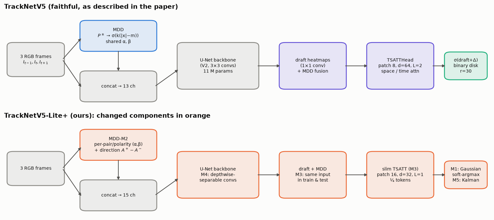
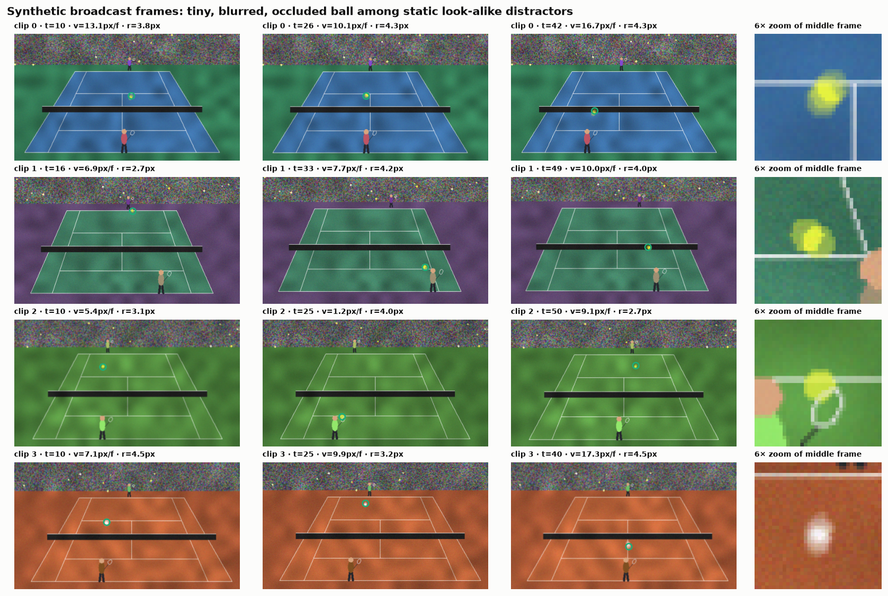
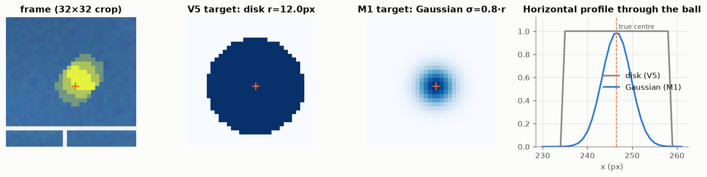

# Tracking High-Speed & Tiny Objects in Sports
**Re-implementing TrackNetV5 (2025) and improving it → TrackNetV5-Lite+**

A Deep Learning course project (Semester VII). Everything lives in one notebook, **[`TrackNetV5_TinyObject_Tracking.ipynb`](TrackNetV5_TinyObject_Tracking.ipynb)**. It covers the theory, data, models, training, ablations and visual analysis. Models are pre-trained on synthetic broadcasts, then **fine-tuned on real TrackNet tennis footage (games 1–8) and tested on unseen games 9–10**. The full run is designed for a free **Kaggle GPU** (T4 / P100, ≈ 5 h). A reduced CPU profile is available for local debugging.



## What's inside
| | |
|---|---|
| **Base paper** | H. Tang, Y. Chen, L. Jiang, *TrackNetV5: Residual-Driven Spatio-Temporal Refinement and Motion Direction Decoupling for Fast Object Tracking*, arXiv:2512.02789 (Dec 2025) |
| **Context papers** | TrackNet V1 (2019), V2 (2020), V3 (2023), V4 (arXiv:2409.14543, 2024) |
| **Data** | A procedural broadcast-video generator (perspective court, ballistic ball with bounces, motion blur, occluding players, static look-alike distractors, dead-ball segments) with exact labels, for pre-training and controlled ablations. **Real:** the TrackNet tennis dataset (10 matches, 19,835 frames), split by match: fine-tune on games 1–8, test on games 9–10. |
| **Models** | TrackNetV2 (baseline) · TrackNetV5 faithful (MDD + R-STR Transformer) · 4 ablation rungs with our modifications |
| **Our modifications** | **M1** Gaussian target + soft-argmax · **M2** per-polarity MDD + direction channel · **M3** consistent, slim R-STR head · **M4** depthwise-separable backbone · **M5** Kalman gating + ballistic gap filling |
| **Documentation** | [`CHANGES.md`](CHANGES.md): every change vs. the paper, why it was made, its trade-off and its measured effect |

## Results
**Already measured** (exact, no training needed). At 512×288, our V2 backbone reproduces the paper's size: it scales to ≈ 11.3 M params and ≈ 113 GMACs at full width, against 11.33 M and 112.89 G in the paper. Our final **V5-Lite+ uses 0.13× the parameters and 0.19× the FLOPs of the faithful V5**. See [`CHANGES.md` §3](CHANGES.md#3-efficiency-summary-measured-exact).

**Accuracy** (F1, precision, recall, localisation error, robustness per speed, size and occlusion) is produced by the Kaggle run. The notebook writes:
- `results/ablation_gpu.csv` (synthetic test set);
- `results/real_tennis_gpu.csv` (real games 9–10: zero-shot, fine-tuned and fine-tuned + M5);
- `results/changes_measured_gpu.md`, with both per-change tables;
- figures 06–18 and `figures/tracking_demo.gif`.

§10 prints a per-change verdict, generated from the measured numbers, for both the synthetic and the real test set.

**Report assets.** The last section of the notebook (§12) writes `results/REPORT_ASSETS.md`. It maps every report section to its files and checks that each one exists:
- architecture diagrams `fig02`, `fig19`, plus a layer table;
- algorithm steps in §5.2;
- dataset figures and table `tab00`;
- tools and environment `tab06`;
- result tables `tab01`–`tab05` as images, plus figures 06–20;
- a comparison with TrackNet V1–V5;
- the novel contributions in §1.4.2.

The code link, individual contribution and learning outcomes are left for you to write.

| Synthetic training data (512×288) | Disk (V5) vs. Gaussian (M1) targets |
|---|---|
|  |  |

## Repository layout
```
.
├── TrackNetV5_TinyObject_Tracking.ipynb   # the whole project (replace with the executed Kaggle version)
├── CHANGES.md                             # modifications vs. the paper: motivation, trade-offs, measured gains
├── README.md
├── requirements.txt
├── .gitignore                             # ignores .venv/, data/, checkpoints/, *.pt …
├── figures/                               # all figures produced by the notebook (+ tracking_demo.gif)
├── results/                               # ablation tables (CSV/JSON) produced by the notebook
├── tests/                                 # pytest suite (imports the notebook's functions)
├── checkpoints/   (git-ignored)           # cached model weights; re-used on re-runs
└── Input/         (git-ignored)           # real TrackNet tennis dataset: Input/game1…game10/Clip*/ (also found in data/tennis/)
```

## Setup
Requires Python 3.10–3.12. With [uv](https://github.com/astral-sh/uv):
```bash
uv venv --python 3.12 .venv
uv pip install --python .venv -r requirements.txt
```
or with plain pip:
```bash
python -m venv .venv
.venv\Scripts\activate          # Windows  (Linux/macOS: source .venv/bin/activate)
pip install -r requirements.txt
```
The requirements pull the **CPU** build of PyTorch. For a CUDA GPU, install torch from the matching index first (e.g. `--index-url https://download.pytorch.org/whl/cu121`).

## Running on Kaggle (recommended)
1. **Upload the dataset once.** Zip the `Input` folder (2.6 GB; make sure OneDrive has it fully downloaded first). Then go to kaggle.com → **Create → New Dataset**, drop in the zip, name it e.g. `tracknet-tennis` and keep it private. Kaggle unzips it.
2. Go to **Create → New Notebook → File → Import Notebook**, and upload `TrackNetV5_TinyObject_Tracking.ipynb`.
3. Click **+ Add Input** and attach your `tracknet-tennis` dataset. The notebook finds the `Label.csv` files anywhere under `/kaggle/input`.
4. Under **Settings**, set **Accelerator → GPU T4 ×1** (or P100). This needs a phone-verified account. Internet is not needed.
5. *(Optional, ~5 min)* Add a first cell with `import os; os.environ["TN_SMOKE"] = "1"` and click **Run All** to check that everything works. Then delete that cell and use **Run → Restart**.
6. Click **Save Version → Save & Run All (Commit)**. It runs headless (12 h limit) and does not need the browser tab to stay open. The `gpu` profile is selected automatically.

**Expected time on a T4** (estimates; a P100 is ~20–30 % faster):

| Stage | Time |
|---|---|
| Load the real dataset (19.8k JPEGs → 512×288) + render the synthetic data | ~5–8 min |
| Pre-train 6 models on synthetic data (6,000 steps each) | ~2.5–3 h |
| Fine-tune 6 models on real games 1–8 (3,000 steps each) | ~1.3–1.5 h |
| Evaluation, figures, M5 tracker, real test games 9–10 | ~15 min |
| **Total** | **≈ 4.5–5 h** of the 30 h/week free GPU quota |

Each committed Kaggle version starts from an empty working folder, so an interrupted run starts over. Do the optional smoke check in step 5 first.

7. When it finishes, open the version's **Output** tab and download:
   - the executed notebook;
   - `tracknet_outputs.zip`, which contains `figures/`, `results/` and `checkpoints/`.
8. Back in this repo:
   - replace the notebook with the executed one;
   - unzip the archive into the repo root. `checkpoints/` stays git-ignored; re-running the notebook locally re-uses them instead of retraining.

## Running locally
Open the notebook in Jupyter / VS Code with the `.venv` kernel and *Run All*, or run it headless:
```bash
.venv/Scripts/jupyter nbconvert --to notebook --execute --inplace TrackNetV5_TinyObject_Tracking.ipynb --ExecutePreprocessor.timeout=-1
```
| Environment variable | Effect |
|---|---|
| `TN_PROFILE=gpu` *(default with CUDA)* | the paper's 512×288 resolution, ½ channel width, 150 synthetic clips, 6,000 steps × batch 8 per model, then 3,000 fine-tuning steps on real games 1–8 |
| `TN_PROFILE=gpu_full` | 512×288, full width (the paper's 11 M-param scale), 240 clips, 15,000 steps |
| `TN_PROFILE=cpu` *(default without CUDA)* | 288×160, ¼ width, 48 clips, 1,500 steps × batch 4. Debugging only (≈ 2.5 h on a laptop CPU). |
| `TN_SMOKE=1` | a ~1-minute end-to-end check with tiny data and step counts (no training, results are meaningless) |
| `TN_RETRAIN=1` | ignore cached checkpoints in `checkpoints/` |
| `TN_REAL_ROOT=<path>` | where the real TrackNet dataset is. The default search order is `data/tennis/`, then `Input/`, then `/kaggle/input`. |

## Tests
`tests/` contains 48 pytest checks. They import the notebook's own functions by executing its cells on smoke-sized data in a temp folder, so the repo's `figures/` is never touched. They cover:
- **Data:** rendered ball pixels vs. labels, occlusion and dead-ball semantics, camera shake.
- **Targets and windowing:** target maps, flip augmentation, input channel layout, MIMO window alignment.
- **Models and modules:** every model variant (forward/backward, parameter ordering), MDD polarity semantics, the R-STR identity init and the V5 train/test mismatch.
- **Loss, decoding and metrics:** WBCE, sub-pixel decoding accuracy, TrackNet metric counts.
- **M5:** the Kalman filter on clean, outlier, occlusion, hit and out-of-frame trajectories.
- **Real data:** the TrackNet loader, the game-level split (no test match can leak into training) and variable-length clips.
- **End to end:** full execution of the notebook on both profiles, plus a run with a fake 10-match real dataset so the fine-tuning path executes too.
```bash
.venv/Scripts/python -m pytest -m "not slow"            # unit tests, ~1 min
.venv/Scripts/python -m pytest -k "not tiny_overfit"     # + 3 end-to-end notebook runs, ~12 min
.venv/Scripts/python -m pytest                           # + a ~1 min tiny overfit check (does a little CPU training)
```

### Real data
Place the TrackNet tennis dataset (Huang et al., 2019) as `Input/game*/Clip*/` (frames + `Label.csv`). Without it, the notebook still runs on synthetic data only and skips §9.5.

## References
1. Huang et al., *TrackNet: A Deep Learning Network for Tracking High-speed and Tiny Objects in Sports Applications*, AVSS 2019 (arXiv:1907.03698)
2. Sun et al., *TrackNetV2: Efficient Shuttlecock Tracking Network*, ICPAI 2020
3. Chen & Wang, *TrackNetV3: Enhancing ShuttleCock Tracking with Augmentations and Trajectory Rectification*, ACM MM Asia 2023
4. Raj, Wang & Gedeon, *TrackNetV4: Enhancing Fast Sports Object Tracking with Motion Attention Maps*, arXiv:2409.14543 (2024)
5. Tang, Chen & Jiang, *TrackNetV5: Residual-Driven Spatio-Temporal Refinement and Motion Direction Decoupling for Fast Object Tracking*, arXiv:2512.02789 (2025)
6. Bertasius et al., *Is Space-Time Attention All You Need for Video Understanding?* (TimeSformer), ICML 2021
